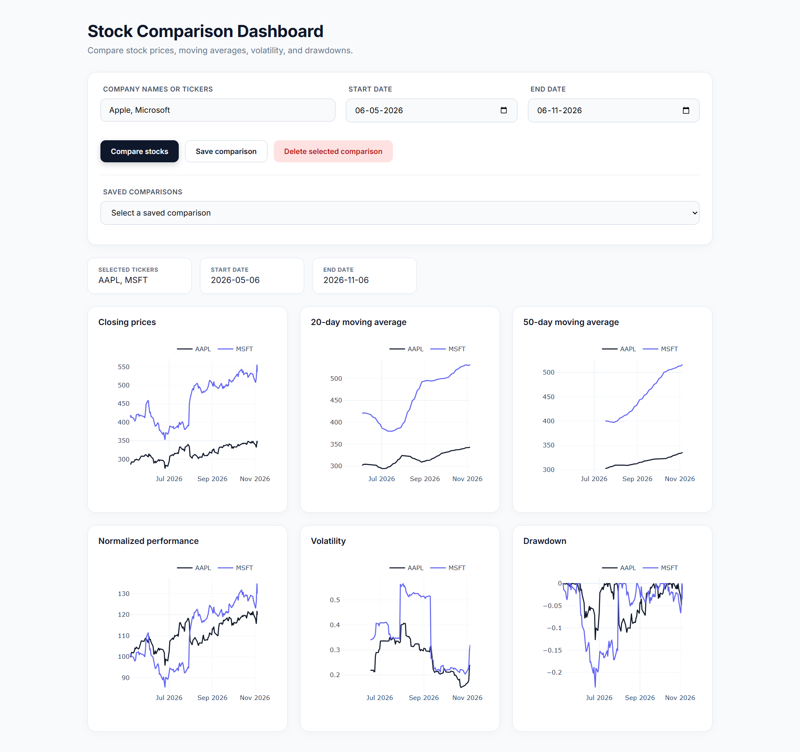

# StockLens

This project is a full-stack web application that allows users to compare and visualise historical stock performance, 20-day and 50-day moving averages, and risk metrics such as volatility and drawdowns for up to 3 companies together.

## Features
* **Company name and Ticker Search:** Accepts company names or tickers and looks up the correct symbol using the Yahoo Finance API.
* **Interactive Charts:** Generates six dynamic Plotly charts, including 20-day and 50-day moving averages and normalized historical performance.
* **Saving and Reloading Stock Comparisons:** Users can save their comparisons to a local SQLite database and instantly reload them.
* **Error Handling:** Catches misspelled company names and returns helpful feedback rather than failing silently.

## Tech Stack
* **Backend:** Python, FastAPI
* **Data Processing:** Pandas, NumPy, yfinance
* **Database:** SQLite
* **Frontend:** JavaScript, HTML/CSS, Plotly.js

## What I built and challenges I solved
This project started as a basic data visualization project in IBM's Python Project for Data Science course, but I was not satisfied with the static nature of the Jupyter Notebook, so I decided to rebuild it as a fully deployed full-stack application. This transition forced me to solve several challenges:

1. **Charts not showing up properly:** Initially, Plotly rendered the charts as invisible lines because the browser hadn't finished setting up the page layout yet. I solved this by using `requestAnimationFrame` to wait until the browser finished laying out the page before plotting the graphs.
2. **Handling inconsistent data formats from yfinance:** The yfinance library returned different Pandas DataFrame structures depending on how many tickers are requested. So I wrote a helper function to reshape the data into a consistent format so that the backend could process them properly.
3. **Catching invalid company names individually:** Originally, if a user typed a mix of valid and invalid company names, the app would just ignore the misspelled names. So, I updated the backend to check each company name input individually, find exactly which names failed, and return a specific error message so the user knows what ticker or company name was incorrect.

## How to Run
1. Clone the repo and navigate to the folder.
2. Install required dependencies: `pip install -r requirements.txt`
3. Start the server by running: `python main.py`
4. Open `http://127.0.0.1:8000` in your browser.

## Future Improvements
* **User Accounts:** Add login support so that different users can save and manage their own private stock comparisons.
* **Temporary Data Caching:** Save recently fetched stock data temporarily, so that repeated searches for the same stock comparison load faster and fewer calls are made to the Yahoo Finance API.
* **Export and Download option:** Let users download the generated charts as images or export the stock comparison data as a CSV file.

---
*Disclaimer: This application was built for educational and computer science portfolio purposes. It displays historical data for visualization only and does not provide financial advice, predictions, or investment recommendations.*